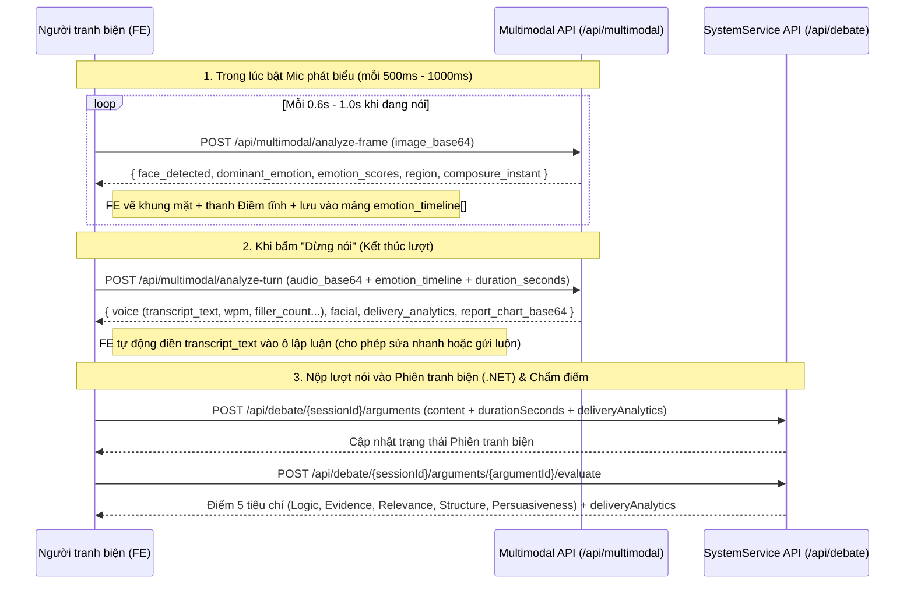

# Tài liệu Tích hợp Frontend (FE Integration Specification)
##Tính năng Tranh biện Đa phương thức: Cảm xúc Khuôn mặt (DeepFace) + Giọng nói (Faster-Whisper) + Chấm điểm AI

Tài liệu này mô tả chi tiết các API, cấu trúc Request/Response JSON và luồng tích hợp chuẩn cho đội ngũ **Frontend (React / Next.js / Vue / Mobile)** khi ghép tính năng nhận diện biểu cảm khuôn mặt (`DeepFace YuNet`), nhận dạng giọng nói tiếng Việt (`Faster-Whisper`) và chấm điểm tranh biện vào hệ thống **ADPP**.

---

## 1. Base URL & Định tuyến qua API Gateway

Tất cả các API đều đã được cấu hình sẵn trên **YARP API Gateway** (`http://localhost:5000`) và hỗ trợ CORS (`*`):

| Dịch vụ đích | Qua API Gateway (Khuyến nghị cho FE) | Gọi trực tiếp Service (Local Dev) |
| :--- | :--- | :--- |
| **Multimodal Service** (DeepFace + Whisper) | `http://localhost:5000/api/multimodal/*` | `http://localhost:8003/multimodal/*` |
| **System Service** (.NET Debate Core) | `http://localhost:5000/api/debate/*` | `http://localhost:5001/api/debate/*` |
| **AI Evaluator Service** (Chấm điểm) | `http://localhost:5000/api/evaluate/*` | `http://localhost:8000/evaluate/*` |

---

## 2. Luồng Hoạt động Chuẩn cho Frontend (3 Bước)



---

## 3. Chi tiết từng API Endpoint cho Frontend

### 3.1. Kiểm tra trạng thái Model AI (Health Check)
- **Endpoint:** `GET /health` (trực tiếp `http://localhost:8003/health`)
- **Mục đích:** FE kiểm tra xem `DeepFace (YuNet)` và `Faster-Whisper` đã sẵn sàng chưa để bật nút thu âm/camera.
- **Response `200 OK`:**
```json
{
  "status": "ok",
  "service": "ai-multimodal-service",
  "models": {
    "deepface_ready": true,
    "detector_backend": "yunet",
    "whisper_ready": true,
    "deepface_source": "D:\\Emotion-Test\\deepface\\deepface\\DeepFace.py"
  }
}
```

---

### 3.2. Phân tích Cảm xúc Khuôn mặt theo Khung hình (`POST /api/multimodal/analyze-frame`)
- **Endpoint:** `POST http://localhost:5000/api/multimodal/analyze-frame`
- **Khi nào FE gọi?** Trong lúc người dùng đang phát biểu, dùng `setInterval(..., 600)` vẽ `<video>` ra `<canvas>` kích thước nhỏ (`320x240`), xuất `canvas.toDataURL('image/jpeg', 0.75)` và gửi lên.
- **Request Body (`application/json`):**
```json
{
  "image_base64": "data:image/jpeg;base64,/9j/4AAQSkZJRgABAQAAAQABAAD...",
  "timestamp": 4.2
}
```
- **Response `200 OK`:**
```json
{
  "face_detected": true,
  "dominant_emotion": "neutral",
  "dominant_score": 82.4,
  "emotion_scores": {
    "neutral": 82.4,
    "happy": 11.2,
    "surprise": 3.1,
    "sad": 1.5,
    "angry": 0.8,
    "fear": 0.6,
    "disgust": 0.4
  },
  "face_confidence": 0.942,
  "region": {
    "x": 92,
    "y": 45,
    "w": 118,
    "h": 146
  },
  "composure_instant": 93.6,
  "timestamp": 4.2
}
```
- **Cách FE xử lý Response:**
  - Nếu `face_detected === true`:
    - Dùng `region: { x, y, w, h }` để vẽ khung chữ nhật quanh mặt người nói.
    - Hiển thị nhãn `dominant_emotion` + `dominant_score`% và cập nhật thanh Điềm tĩnh (`composure_instant`%).
    - Đẩy phần tử vào mảng `emotionTimeline`:
      ```js
      emotionTimeline.push({
        time: data.timestamp,
        dominant: data.dominant_emotion,
        scores: data.emotion_scores,
        face_detected: true
      });
      ```

---

### 3.3. Phân tích Trọn vẹn Lượt phát biểu (`POST /api/multimodal/analyze-turn`)
- **Endpoint:** `POST http://localhost:5000/api/multimodal/analyze-turn`
- **Khi nào FE gọi?** Ngay khi người dùng nhấn nút **"⏹️ Kết thúc lượt nói"**.
- **Lưu ý cho FE:** Có 2 cách truyền dữ liệu hình ảnh khuôn mặt (chọn 1 trong 2):
  1. Truyền `emotion_timeline` (đã thu được từ bước 3.2 ở trên) $\rightarrow$ **Nhanh nhất vì không phải phân tích lại ảnh**.
  2. Hoặc truyền mảng `frames_base64: ["data:image/jpeg;base64,...", ...]` (nếu FE không gọi `analyze-frame` trong lúc nói mà chỉ chụp vài tấm ảnh gửi 1 lần cuối lượt).
- **Request Body (`application/json`):**
```json
{
  "audio_base64": "data:audio/wav;base64,UklGRiQAAABXQVZFZm10IBAAAAABAAEA...",
  "emotion_timeline": [
    {
      "time": 0.6,
      "dominant": "neutral",
      "scores": { "neutral": 82.4, "happy": 11.2 },
      "face_detected": true
    },
    {
      "time": 1.2,
      "dominant": "happy",
      "scores": { "happy": 68.0, "neutral": 25.0 },
      "face_detected": true
    }
  ],
  "total_frames_captured": 2,
  "duration_seconds": 15.4,
  "transcript_override": null,
  "include_report_chart": true
}
```
- **Response `200 OK`:**
```json
{
  "overall_demeanor_score": 91.0,
  "voice": {
    "transcript_text": "Kính thưa ban giám khảo, mạng xã hội làm suy giảm tương tác trực tiếp vì giới trẻ dành quá nhiều thời gian trước màn hình.",
    "duration_seconds": 15.4,
    "word_count": 26,
    "wpm": 101.3,
    "pace_evaluation": "Khá chậm / Ngập ngừng",
    "pace_score": 80.0,
    "filler_count": 1,
    "filler_words_found": {
      "ờ": 1
    },
    "fluency_score": 85.0
  },
  "facial": {
    "total_frames_analyzed": 2,
    "face_detected_frames": 2,
    "eye_contact_rate": 100.0,
    "dominant_emotion": "neutral",
    "composure_score": 100.0,
    "emotion_counts": {
      "neutral": 1,
      "happy": 1,
      "surprise": 0,
      "sad": 0,
      "angry": 0,
      "fear": 0,
      "disgust": 0
    },
    "emotion_pct": {
      "neutral": 50.0,
      "happy": 50.0,
      "surprise": 0.0,
      "sad": 0.0,
      "angry": 0.0,
      "fear": 0.0,
      "disgust": 0.0
    }
  },
  "delivery_analytics": {
    "dominant_emotion": "neutral",
    "eye_contact_rate": 100.0,
    "composure_score": 100.0,
    "confidence_score": 94.0,
    "wpm": 101.3,
    "pace_evaluation": "Khá chậm / Ngập ngừng",
    "pace_score": 80.0,
    "filler_count": 1,
    "fluency_score": 85.0,
    "overall_demeanor_score": 91.0,
    "emotion_breakdown": {
      "neutral": 50.0,
      "happy": 50.0,
      "surprise": 0.0,
      "sad": 0.0,
      "angry": 0.0,
      "fear": 0.0,
      "disgust": 0.0
    }
  },
  "report_chart_base64": "data:image/png;base64,iVBORw0KGgoAAAANSUhEUgAAB..."
}
```
- **Cách FE xử lý Response:**
  - Lấy `voice.transcript_text` gán vào ô nội dung lập luận để người dùng gửi đi.
  - Lưu cục `delivery_analytics` lại để truyền kèm khi gọi API nộp bài bên `.NET SystemService`.
  - Nếu muốn hiển thị ngay biểu đồ tổng kết của DeepFace, chỉ cần gắn ``.

---

### 3.4. Nộp Lập luận kèm Chỉ số Phong thái vào Phiên Tranh biện (`POST /api/debate/{sessionId}/arguments`)
- **Endpoint:** `POST http://localhost:5000/api/debate/{sessionId}/arguments`
- **Headers:** `Authorization: Bearer <JWT_TOKEN>`, `Content-Type: application/json`
- **Request Body (`SubmitArgumentRequest`):**
  - Hai trường `durationSeconds` và `deliveryAnalytics` là **tùy chọn (optional)** — nếu người dùng chỉ gõ phím không bật mic/camera thì FE chỉ cần gửi `{ "content": "..." }` như cũ.
  - Nếu người dùng có dùng Mic/Camera, FE truyền nguyên cục `delivery_analytics` nhận được từ bước 3.3 vào:
```json
{
  "content": "Kính thưa ban giám khảo, mạng xã hội làm suy giảm tương tác trực tiếp vì giới trẻ dành quá nhiều thời gian trước màn hình.",
  "durationSeconds": 15,
  "deliveryAnalytics": {
    "dominant_emotion": "neutral",
    "eye_contact_rate": 100.0,
    "composure_score": 100.0,
    "confidence_score": 94.0,
    "wpm": 101.3,
    "pace_evaluation": "Khá chậm / Ngập ngừng",
    "pace_score": 80.0,
    "filler_count": 1,
    "fluency_score": 85.0,
    "overall_demeanor_score": 91.0,
    "emotion_breakdown": {
      "neutral": 50.0,
      "happy": 50.0,
      "surprise": 0.0,
      "sad": 0.0,
      "angry": 0.0,
      "fear": 0.0,
      "disgust": 0.0
    }
  }
}
```

- **Khi FE gọi `GET /api/debate/{sessionId}/transcript`:**
  Mỗi phần tử trong mảng `data.arguments` giờ sẽ trả về thêm `wordCount`, `durationSeconds` và `deliveryAnalytics` để FE hiển thị huy hiệu cảm xúc / WPM ngay cạnh từng bong bóng chat trong biên bản tranh biện!

---

### 3.5. API "All-in-One" Chấm điểm Nhanh Lượt nói (`POST /api/multimodal/evaluate-speech`)
- **Endpoint:** `POST http://localhost:5000/api/multimodal/evaluate-speech`
- **Khi nào FE dùng?** Dùng cho màn hình **Luyện tập độc lập (Solo Practice / Quick Coach)** khi FE muốn gửi 1 lần duy nhất (Audio + Emotion + Chủ đề Motion) và nhận về **cả Báo cáo Phong thái (DeepFace + Whisper) lẫn Điểm Nội dung 5 tiêu chí (AI Evaluator)**.
- **Request Body (`application/json`):**
```json
{
  "motion": "THBT mạng xã hội gây hại nhiều hơn lợi",
  "side": "pro",
  "stage": "rebuttal",
  "opponent_argument_text": "Mạng xã hội giúp kết nối mọi người ở xa nhau.",
  "turn_data": {
    "audio_base64": "data:audio/wav;base64,...",
    "emotion_timeline": [
      { "time": 1.0, "dominant": "neutral", "scores": { "neutral": 85.0 }, "face_detected": true }
    ],
    "total_frames_captured": 1,
    "duration_seconds": 12.0,
    "transcript_override": "Mạng xã hội làm suy giảm tương tác trực tiếp bởi vì giới trẻ dành quá nhiều thời gian trước màn hình.",
    "include_report_chart": true
  }
}
```
- **Response `200 OK`:**
```json
{
  "multimodal": {
    "overall_demeanor_score": 100.0,
    "voice": { "...": "..." },
    "facial": { "...": "..." },
    "delivery_analytics": { "...": "..." },
    "report_chart_base64": "data:image/png;base64,..."
  },
  "argument_text_used": "Mạng xã hội làm suy giảm tương tác trực tiếp bởi vì giới trẻ dành quá nhiều thời gian trước màn hình.",
  "content_evaluation": {
    "overall_score": 7.5,
    "overall_reasoning": "Lập luận bám sát chủ đề...",
    "criteria": [
      { "name": "Logic", "score": 4, "reasoning": "..." },
      { "name": "Evidence", "score": 3, "reasoning": "..." },
      { "name": "Relevance", "score": 4, "reasoning": "..." },
      { "name": "Structure", "score": 4, "reasoning": "..." },
      { "name": "Persuasiveness", "score": 4, "reasoning": "..." }
    ],
    "strengths": [
      "Lập luận đi thẳng vào trọng tâm chủ đề tranh biện.",
      "[Phong thái - DeepFace] Biểu cảm khuôn mặt rất điềm tĩnh và tự tin (Composure đạt 100.0%, cảm xúc chủ đạo: neutral)."
    ],
    "weaknesses": [
      "Cần bổ thêm dẫn chứng số liệu hoặc nghiên cứu cụ thể để tăng sức nặng."
    ],
    "suggestions": [
      "Áp dụng mô hình Claim - Warrant - Impact (Luận điểm - Lý lẽ - Tác động) kèm số liệu thực tế."
    ],
    "scoring_version": "v2_4x25",
    "delivery_analytics": { "...": "..." }
  },
  "evaluation_error": null
}
```

---

## 4. Code Mẫu TypeScript / React Hook cho FE Copy & Dùng Ngay

FE có thể tham khảo trực tiếp mã nguồn mẫu đang chạy tại `AiServices/ai-multimodal-service/app/demo_page.py` hoặc dùng các interface TypeScript sau:

```typescript
export interface DeliveryAnalytics {
  dominant_emotion: string;
  eye_contact_rate: number;
  composure_score: number;
  confidence_score: number;
  wpm: number;
  pace_evaluation: string;
  pace_score: number;
  filler_count: number;
  fluency_score: number;
  overall_demeanor_score: number;
  emotion_breakdown: Record<string, number>;
}

export interface EmotionSample {
  time: number;
  dominant: string;
  scores: Record<string, number>;
  face_detected: boolean;
}

// 1. Gọi định kỳ mỗi 600ms trong lúc bật Mic & Camera
export async function analyzeFrame(imageBase64: string, elapsedSeconds: number) {
  const res = await fetch('http://localhost:5000/api/multimodal/analyze-frame', {
    method: 'POST',
    headers: { 'Content-Type': 'application/json' },
    body: JSON.stringify({ image_base64: imageBase64, timestamp: elapsedSeconds }),
  });
  return res.json();
}

// 2. Gọi ngay khi người dùng bấm "Dừng nói"
export async function analyzeTurn(
  audioBase64: string,
  emotionTimeline: EmotionSample[],
  totalFrames: number,
  durationSeconds: number
) {
  const res = await fetch('http://localhost:5000/api/multimodal/analyze-turn', {
    method: 'POST',
    headers: { 'Content-Type': 'application/json' },
    body: JSON.stringify({
      audio_base64: audioBase64,
      emotion_timeline: emotionTimeline,
      total_frames_captured: totalFrames,
      duration_seconds: durationSeconds,
      include_report_chart: true,
    }),
  });
  return res.json();
}
```

